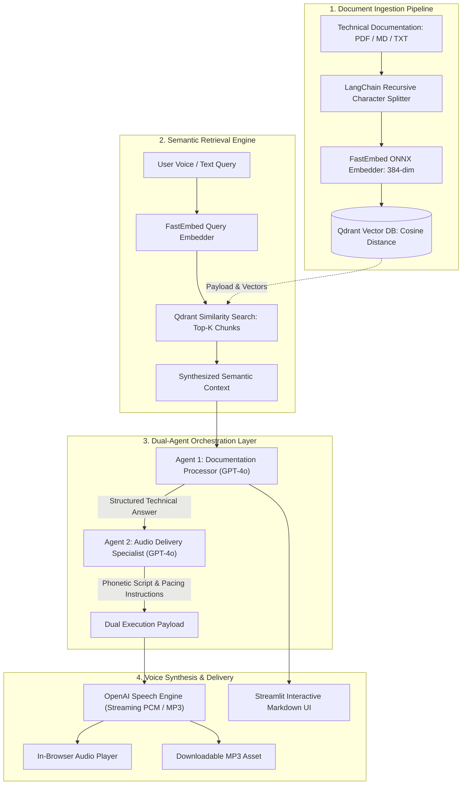

# 🎙️ Voice RAG Agent — Conversational Documentation Intelligence Platform

[](https://www.python.org/)
[](https://platform.openai.com/)
[](https://qdrant.tech/)
[-green.svg)](https://github.com/qdrant/fastembed)
[](https://python.langchain.com/)
[](https://streamlit.io/)
[](LICENSE)

An enterprise-grade, voice-enabled **Retrieval-Augmented Generation (RAG)** platform designed for technical documentation intelligence. By coupling dense vector semantic retrieval with a **dual-agent AI orchestration pipeline** and **real-time streaming text-to-speech**, the system converts static documentation (PDFs, Markdown, and TXT) into natural, citation-grounded, spoken conversational answers.

---

## 📌 Executive Summary & Architecture Highlights

* **Dense Semantic Vector Search**: Employs ONNX-accelerated dense embeddings (`FastEmbed` / BAAI `bge-small-en-v1.5`) indexed in **Qdrant Vector Database** with cosine similarity distance metric for high-precision document chunk retrieval.
* **Dual-Agent Orchestration**:
  1. **Documentation Processor Agent**: Ingests top-$k$ retrieved semantic chunks, isolates technical answers, incorporates code examples, and verifies source citations.
  2. **Audio Script Delivery Agent**: Transforms technical prose into conversational phonetic phrasing with strategic pause cadence tailored for natural voice synthesis.
* **Multi-Persona Real-Time Speech Synthesis**: Streams low-latency audio via OpenAI's speech models across 11 voice personas (`coral`, `alloy`, `echo`, `nova`, `shimmer`, `onyx`, etc.) with in-browser streaming playback and direct MP3 export.
* **Resilient Infrastructure & Flexible Deployments**: Supports single-command Dockerized Qdrant, managed Qdrant Cloud clusters, and a zero-dependency in-memory mode (`:memory:`) for offline/local evaluations.

---

## 🏗️ System Architecture



---

## 📂 Repository Structure

```text
voice_rag_openaisdk/
├── .streamlit/
│   └── config.toml             # Custom dark-slate theme and server configurations
├── examples/
│   └── sample_documentation.md # Architecture reference documentation for instant testing
├── .env.example                # Template for environment variables and API credentials
├── .gitignore                  # Git ignore rules for caches, credentials, and audio artifacts
├── app.py                      # Primary application entrypoint
├── docker-compose.yml          # One-click Qdrant vector database container setup
├── LICENSE                     # MIT Open Source License
├── rag_voice.py                # Core RAG, Dual-Agent, and Voice Synthesis Engine
└── requirements.txt            # Python package dependencies with verified versions
```

---

## 🚀 Quickstart Guide

### 1. Prerequisites
* **Python 3.10+**
* **OpenAI API Key** ([platform.openai.com](https://platform.openai.com/api-keys))
* *(Optional)* **Docker & Docker Compose** (for local Qdrant deployment)

### 2. Clone and Setup Environment

```bash
# Clone the repository
git clone https://github.com/Vaibhav1376/voice-rag-agent.git
cd voice-rag-agent

# Create and activate virtual environment
python -m venv .venv
source .venv/bin/activate    # On Windows: .venv\Scripts\activate

# Install dependencies
pip install -r requirements.txt
```

### 3. Configure Environment Variables

Copy `.env.example` to `.env` and provide your credentials:

```bash
cp .env.example .env
```

Edit `.env`:
```env
OPENAI_API_KEY=sk-...
QDRANT_URL=http://localhost:6333
QDRANT_API_KEY=
DEFAULT_VOICE=coral
```

> **Note**: If you don't want to run Qdrant via Docker or Cloud, simply set `QDRANT_URL=:memory:`. The agent will run fully in-memory with zero external setup!

### 4. (Optional) Launch Local Qdrant via Docker

```bash
docker compose up -d
```
* Qdrant REST API: `http://localhost:6333`
* Qdrant Web Dashboard: `http://localhost:6333/dashboard`

### 5. Launch the Application

```bash
streamlit run app.py
```

The web dashboard will automatically open at `http://localhost:8501`.

---

## 🎙️ Available Voice Personas

Select between 11 natural voice profiles in the sidebar:

| Voice | Gender / Tone | Optimal Use Case |
| :--- | :--- | :--- |
| **Coral** *(Default)* | Warm, clear, expressive | General technical walkthroughs & tutorials |
| **Alloy** | Balanced, neutral | API and architecture specifications |
| **Echo** | Warm, resonant | Deep-dive explanations and conceptual guides |
| **Nova** | Friendly, dynamic | Interactive Q&A and onboarding |
| **Onyx** | Authoritative, grounded | Formal compliance and engineering reports |
| **Shimmer** | Crisp, bright | Quick summaries and status reviews |
| **Sage** | Calm, thoughtful | Analytical and architectural trade-off analysis |

---

## 🛠️ Technology Stack

| Component | Technology | Role |
| :--- | :--- | :--- |
| **LLM Reasoning** | OpenAI GPT-4o | Dual-agent document comprehension & script formatting |
| **Voice Synthesis** | OpenAI Speech (`tts-1` / `gpt-4o-mini-tts`) | Low-latency audio streaming & MP3 encoding |
| **Vector Database** | Qdrant | Dense vector indexing, payload storage, & similarity search |
| **Embeddings** | FastEmbed (`bge-small-en-v1.5`) | High-throughput ONNX-accelerated CPU embeddings |
| **Text Processing** | LangChain Text Splitters | Recursive semantic chunking with metadata tracking |
| **Frontend UI** | Streamlit | Responsive real-time audio playback and chat interface |
| **Containerization** | Docker & Docker Compose | Local vector database orchestration |

---

## 💼 Resume & Portfolio Highlights

For technical resumes, LinkedIn, and recruiter presentations:

* **Voice-Enabled Documentation Intelligence Agent** (`Python`, `OpenAI GPT-4o`, `Qdrant`, `FastEmbed`, `LangChain`, `Streamlit`)
  * *Designed and deployed a voice-enabled RAG system that automates technical documentation lookup by combining dense vector retrieval with low-latency speech synthesis.*
  * *Implemented a dual-agent architecture separating technical extraction (GPT-4o) from spoken-word pacing and phonetic optimization, enhancing audio comprehension for complex documentation.*
  * *Architected semantic retrieval pipeline using Qdrant vector database and FastEmbed ONNX models, achieving sub-second cosine similarity search over chunked technical literature.*
  * *Engineered streaming audio playback with graceful fallback mechanisms supporting local speakers, in-browser playback, and MP3 asset downloads.*

---

## 📄 License

This project is open-source under the [MIT License](LICENSE) — Copyright © 2026 Vaibhav Kakad.
